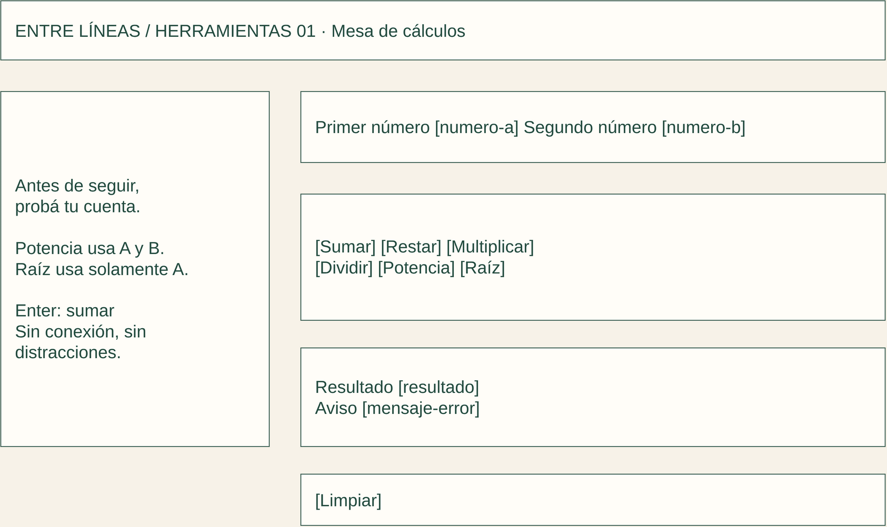
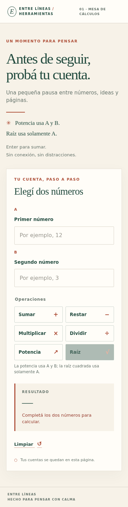
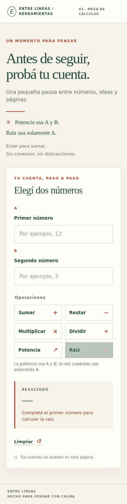
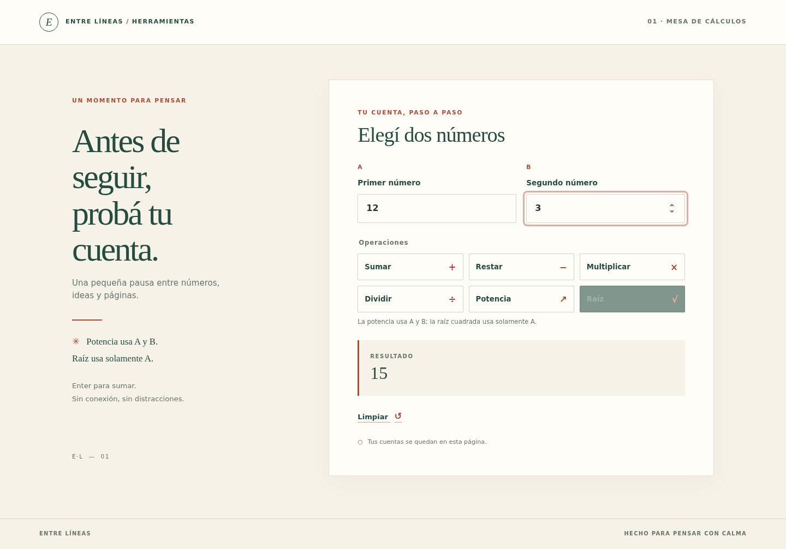
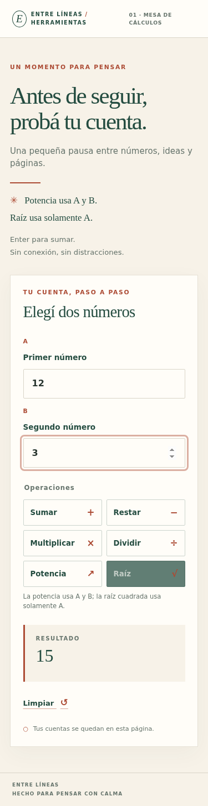

# Mesa de cálculos

## 🧩 Datos generales

| Campo | Detalle |
| --- | --- |
| Integrante 1 | Sara Cohen |
| Integrante 2 | No corresponde: trabajo individual |
| Modelos de IA utilizados | ChatGPT; GPT-6 Luna (implementación y revisión) |
| Tecnologías del proyecto | HTML5, CSS3, JavaScript, Markdown, Visual Studio Code y GitHub |
| Link del repositorio | https://github.com/2023saracohen-yeshurun/calculadora-cientifica |

---

## 📄 Sketch

Boceto guardado antes de la implementación.

## Planeamiento

Diseño editorial: papel crema, tinta verde pino y acentos terracota. Títulos serif, controles grandes y disposición adaptable.

## 💬 Prompts utilizados

### Encargo inicial — resumen funcional

> Implementá una calculadora con dos operandos para suma, resta, multiplicación y división, y una acción para limpiar. Usá los IDs `numero-a`, `numero-b`, `resultado` y `mensaje-error`. Los campos vacíos no equivalen a cero; la división por cero debe mostrar un error, y un resultado no finito también debe mostrar un error. Enter ejecuta la suma. En esta primera etapa, dejá potencia y raíz visibles pero deshabilitadas. La interfaz debe respetar el boceto y la identidad editorial especificada, ser responsive y accesible, y usar HTML, CSS y JavaScript sin frameworks.

### Prompt 2 — operaciones científicas

> Agregá potencia y raíz; raíz usa solo el primer operando, validá negativos y resultados no finitos

### Prompt 3 — teclado y accesibilidad

> Revisá el comportamiento por teclado, ejecutá suma con Enter y preservá los mensajes accesibles y el diseño móvil

## Versiones

- Node.js: `v22.23.3` (verificado con el ejecutable indicado).
- HTML, CSS y JavaScript: sin dependencias o frameworks externos.

## Corrección verificada en navegador

Al presionar Raíz con A vacío, la página mostraba «Completá los dos números para calcular», aunque esta operación solo necesita A. Se reprodujo en Chrome y se guardó una captura del mensaje.

### Prompt 4 — corrección de validación

> Al elegir Raíz con el primer campo vacío, el error pide completar dos números. Corregí ese mensaje para pedir solamente el primer número. Conservá la validación de ambos operandos para las otras operaciones y agregá una prueba que impida volver a mostrar el mensaje incorrecto.

**Resultado mejorado:** Raíz con A vacío ahora muestra «Completá el primer número para calcular la raíz». La prueba que reproducía el fallo pasó después de corregirlo.

## Enlaces

[Sitio del proyecto](https://2023saracohen-yeshurun.github.io/calculadora-cientifica/)

[Repositorio](https://github.com/2023saracohen-yeshurun/calculadora-cientifica)

[PDF de la entrega](evidencias/Preentrega3_Cohen_Sara.pdf)

## Estado del proyecto

- [x] Sketch previo al código.
- [x] Prompts y decisiones registrados.
- [x] Pruebas de lógica y navegador realizadas.
- [x] Archivos publicados en el repositorio público.
